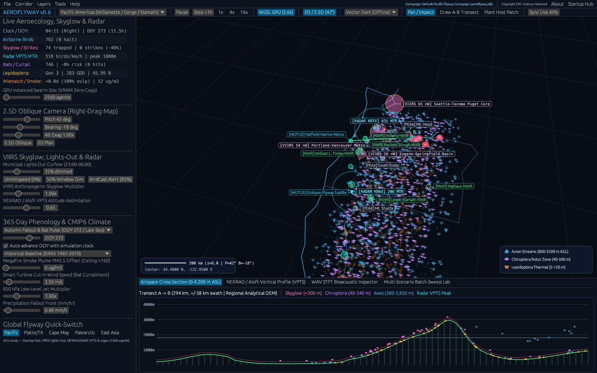

# AeroFlyway v0.6.0



Pure-Rust desktop aeroecology GIS (`#![forbid(unsafe_code)]` library core, `#![deny(unsafe_code)]` binary with strictly scoped Windows `AttachConsole` FFI), `wgpu`/WGSL 100,000-agent multi-flyway simulator, **Startup Campaign Hub**, **VIIRS nighttime skyglow `Lights-Out` urban collision model**, **NEXRAD WSR-88D / ENRAM Aloft vertical radar profile (`VPTS`) analyzer**, continuous 365-day phenology engine, and WAV/GUANO bioacoustic STFT workbench.

- **User Guide**: [`docs/USER_GUIDE.md`](docs/USER_GUIDE.md)
- **Scientific Methods & Equations**: [`docs/SCIENTIFIC_METHODS.md`](docs/SCIENTIFIC_METHODS.md)
- **Headless Validation Telemetry**: [`validation/README.md`](validation/README.md)

## Scientific & Architectural Highlights

- **Startup Campaign Hub & SQLite WAL Store (`src/main.rs`, `src/db.rs`)**:
  - Launches into an interactive **Startup Campaign Hub** (`AppStage::StartupHub`, bypassable via `--skip-hub`) with SQLite WAL `.db` campaign management, 5 global flyway cards (`Pacific Americas`, `Central/Mississippi`, `Atlantic Americas`, `East Atlantic Palearctic`, `East Asian-Australasian`), pre-flight climate/curfew controls, and one-click mode launchers.
- **CPU/GPU Parity for VIIRS Nighttime Skyglow & `Lights-Out` Curfews (`src/physics.rs`, `src/gpu_pipeline.rs`, `src/shaders/compute.wgsl`)**:
  - Models regional VIIRS Day/Night Band (`nW/cm^2/sr`) urban skyglow domes, `<300 m AGL` canopy disorientation (`flags & 8u`), and non-linear window-lit collision reduction (`Van Doren et al. 2021, PNAS`, exponent `1.68`).
  - Passes the exact `curfew_dim` multiplier inside the 192-byte (`12 x vec4`) `GpuSimUniforms` block so GPU compute and CPU `effective_skyglow_radiance_nw` match across both early-dusk shoulder dimming (`0.32`) and peak `23:00-06:00` curfew dimming (`0.88`).
- **Metric Turbine Encounter Geometry & Continuous-Time Bat Hazard (`src/shaders/compute.wgsl`, `src/physics.rs`)**:
  - Scales turbine longitudinal encounter boxes by `cos(lat)` metric factors (`|Δlat| < 0.032°`, `|Δlon| · cos(lat) < 0.032°`) and integrates rotor-zone bat collision probability with timestep-invariant Poisson hazard `1 - exp(-rate * dt)`.
- **NEXRAD WSR-88D & ENRAM Aloft Vertical Radar Profiles (`src/ingest.rs`)**:
  - Pure-Rust `VPTS` CSV parser (`radar,datetime,height,u,v,...,dens,sd_vvp`), S/C-band clutter filtering (`sd_vvp`), public S3 probes (`unidata-nexrad-level2-chunks`, `aloftdata.s3-eu-west-1.amazonaws.com`), and Migration Traffic Rate (`MTR`, `birds/km/hr`) integration using actual sorted gate thicknesses `Δh` (supporting `100 m`, `200 m`, `500 m`, or non-uniform bins).
- **WAV/GUANO STFT Bioacoustics & Pieretti Power ACI (`src/acoustics.rs`)**:
  - Decodes 8/16/24/32-bit PCM & 32-bit IEEE float `.wav` files with embedded GUANO coordinates, computes power-based (`mag^2`) Pieretti Acoustic Complexity Index across all frames including the final frame, and retains short (`~2 ms`) ultrasonic bat echolocation pulses on multi-second recordings via overlapping analysis hops and max-hold display aggregation.
- **2.5D Oblique & Cross-Sectional Rendering (`src/shaders/map_render.wgsl`, `src/shaders/transect_render.wgsl`, `src/main.rs`)**:
  - Computes normalized perspective clip-space depth (`clip_pos.z`), ground shadow ellipses and vertical altitude drop-lines (`draw(0..18, 0..N)`), `4x4`-subdivided tilted basemap tiles with horizon fade, X-axis distance ticks (`0..total_km`), and viewport aspect-corrected circular transect sprites.

## Desktop Controls & Keyboard Shortcuts

All single-key shortcuts automatically ignore input while typing in any text field (`ctx.wants_keyboard_input()`).

| Shortcut | Action |
|---|---|
| `Space` | Play / Pause multi-taxa simulation |
| `H` | Toggle Startup Campaign Hub <-> 3D GIS Workbench |
| `0` or `R` | Reset camera to active corridor default viewport & 2.5D oblique angle (`42°` pitch, `-18°` bearing) |
| `1` – `4` | Switch bottom dock tabs (`1`: Airspace Transect, `2`: Radar VPTS, `3`: WAV STFT, `4`: Batch Sweep) |
| `T` | Toggle `Draw A-B Transect` map tool <-> `Pan & Inspect` |
| `M` | Toggle `Plant Virtual Milkweed Host Patch` map tool <-> `Pan & Inspect` |
| `L` | Toggle `85%` BirdCast Lights-Out curfew vs `0%` unmitigated (prints status feedback) |
| `Ctrl+K` | Open fuzzy command palette (`Up`/`Down`/`Enter`/`Esc`) for views, corridors, simulation & exports |
| `Ctrl+S` | Save active campaign metadata to SQLite `.db` |
| `Esc` | Dismiss palette or About/Help modal, or reset map tool to `Pan & Inspect` |
| `F1` | Show / hide Shortcuts & Scientific Grounding reference modal |
| Primary-drag / Click | Pan map (`Pan / Inspect`), drag A->B line (`Draw Transect`), or plant patch (`Plant Host Patch`) |
| Secondary-drag | Orbit bearing (`-180°..+180°`) and tilt camera pitch (`0°..62°`) |
| Scroll wheel | Cursor-anchored continuous Web Mercator zoom (`3.5..14.5`) |
| Drag-and-drop | Drop `.wav` audio files into STFT Inspector or `.csv` files into Radar VPTS profiler |

## Quick Start & Headless CLI

```bash
# Launch desktop Startup Campaign Hub + 100k-agent WGSL GIS workstation
cargo run --release

# Launch directly into the 3D GIS workbench (skip Startup Hub)
cargo run --release -- --skip-hub
cargo run --release -- gui --skip-hub

# Print version, help, or list all 5 global flyway corridors, radars, and VIIRS domes
cargo run --release -- --version
cargo run --release -- --help
cargo run --release -- regions

# Render headless offscreen GPU screenshot (1600x1000 RGBA PNG; view 1=Map/Transect, 2=Radar VPTS, 3=WAV STFT)
cargo run --release -- --screenshot validation/view1.png --screenshot-view 1

# Inspect regional NEXRAD / Aloft radar vertical profiles or parse a VPTS CSV
cargo run --release -- radar --region palearctic --smoke-pm25 180 --out-dir exports
cargo run --release -- radar --region pacific --vpts-csv sample_vpts.csv

# Run Rayon multi-scenario sweeps jointly varying turbine cut-in, Lights-Out %, milkweed, dTemp & smoke
cargo run --release -- batch --region atlantic --ssp ssp245 --doy 268 --hours 72 \
  --cut-in 3.5,5.0,6.0 --lights-out 0,50,85 --milkweed-add 0,4,8 --temp-offset 0.0,2.0 \
  --smoke-pm25 0,180 --wind-mult 1.0 --precip 0.4 --db aeroflyway.db --out-dir exports --export-best-geojson

# Batch-process WAV recordings or folders via STFT, export Magma PNGs & pin detections to SQLite
cargo run --release -- inspect-wav sample_calls/ --fft 1024 --export-pngs --pin-db \
  --default-lat 44.4128 --default-lon -123.3285 --db aeroflyway.db --out-dir exports

# Compare migration mortality & BirdCast Lights-Out curfews across all 5 global corridors (JSON + CSV)
cargo run --release -- compare-corridors --doy 272 --hours 24 --lights-out 85 --out-dir exports

# Headless live public API sync (Open-Meteo, CMIP6, CAMS, Radar S3, GLO-90 DEM, iNat, GBIF, USWTDB, eBird)
cargo run --release -- sync --region pacific --ssp ssp245 --warmup-hours 12 \
  --db aeroflyway.db --export-dir exports
```

## Validation Suite & Empirical Metrics

Run the full unit and headless integration validation suite (`23` tests across `src/lib.rs`, `src/main.rs`, and `tests/headless_validation.rs`):

```bash
cargo test --all-targets
```

| Test / Artifact | Verified Metric / Outcome |
|---|---|
| `t1_lights_out_collision_mortality_curve` ([`lights_out_mortality_curve.csv`](validation/lights_out_mortality_curve.csv)) | Atlantic autumn 36h sweep: `0%` Lights-Out (`85.0 nW` -> `10` strikes, `23` entrained) vs `80%` Lights-Out (`25.16 nW` -> `3` strikes, `12` entrained, `87.06%` avoided collision risk) |
| `t2_nexrad_vpts_altitude_profile_integration` ([`vpts_altitude_profile.csv`](validation/vpts_altitude_profile.csv)) | Filters `0 m` `sd_vvp = 1.10 < 2.0 m/s` clutter gate; integrates `12` `KDOX` avian gates (`peak = 600 m ASL`, `44.2 birds/km^3`, `MTR = 1,507.7 birds/km/hr`) |
| `t3_bioacoustic_nfc_stft_classification_and_sqlite_roundtrip` ([`aeroflyway_validation_summary.json`](validation/aeroflyway_validation_summary.json)) | 48 kHz GUANO WAV roundtrip; Thrush `Fc = 3.46 kHz` (`-5.03 dBFS` peak), Warbler `Fc = 7.32 kHz` (`-10.76 dBFS` peak), Pieretti power ACI `419.09`, SQLite persistence verified |
| `t4_global_vector_basemaps_and_label_declutter` | Non-empty coastlines/rivers/borders across all 5 global flyways; `>= 10` zero-overlap decluttered map labels at `z = 5.95` and `z = 6.80` |
| `t5_gpu_swarm_scale_factor_and_export_parity` | Exact `5.0x` GeoJSON/CSV scaling parity between `480` CPU agents and `2,400` GPU agents |
| `t6_bioacoustic_10x_time_expansion_wav_export` | `250 kHz -> 25 kHz` 10x time-expanded WAV export preserves RIFF/GUANO headers, `10x` duration, and `Fc / 10` |
| `t7_low_sample_rate_spectrogram_and_pulse_bounds_regression` | `1.6 kHz` (`0.8 kHz` Nyquist) rendering safety + pulse timestamp bounds on `256`-sample and `6.0 s` WAVs |
| `t8_vpts_variable_bin_height_mtr_scaling` | Exact `5.0x` MTR scaling between `100 m` (`288.0`) and `500 m` (`1,440.0`) gates + non-uniform and CSV roundtrip |
| `t9_skyglow_curfew_parity_dusk_vs_curfew_and_uniform_layout` | 192-byte `GpuSimUniforms` parity (`0.32` dusk `21:00` vs `0.88` curfew `01:00`), Poisson hazard invariance, `cos(lat)` scaling |
| `t10_pieretti_power_aci_and_short_bat_pulse_retention` | Pieretti power ACI upper bound (`<= 2` per bin) & full preservation of `2.4 ms` *Myotis* pulses in `6.0 s` `250 kHz` WAV |

## Citation & CRV Science Apps Hub

- **CRV Science Apps Hub**: <https://crvscience.com/apps>
- **Companion Preprint (`APP-PREPRINT-13`)**: [AeroFlyway: Tracking Bird Migration with Weather Radar, Skyglow Maps, and Nighttime Flight Calls](https://crvscience.com/apps/preprints/aeroflyway-avian-migration-radar)
- **Zenodo Concept DOI**: [10.5281/zenodo.24222366](https://doi.org/10.5281/zenodo.24222366)
- **Machine-Readable Metadata**: [`CITATION.cff`](CITATION.cff)

```bibtex
@article{White2026AeroFlyway,
  author  = {White, Bryan P.},
  title   = {AeroFlyway: Tracking Bird Migration with Weather Radar, Skyglow Maps, and Nighttime Flight Calls},
  journal = {CRV Science Apps Preprints},
  year    = {2026},
  doi     = {10.5281/zenodo.24222366},
  url     = {https://crvscience.com/apps/preprints/aeroflyway-avian-migration-radar},
  note    = {Software v0.6.0; Preprint ID: APP-PREPRINT-13}
}
```
